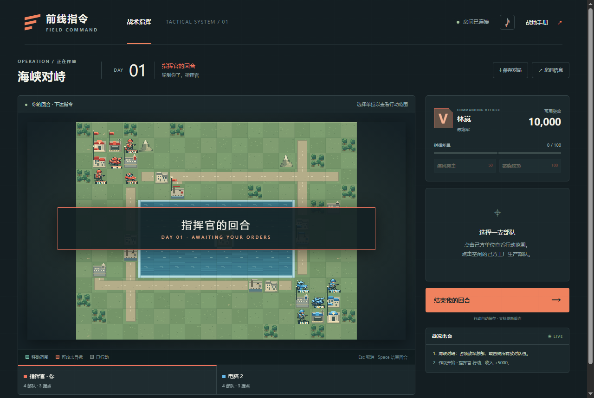
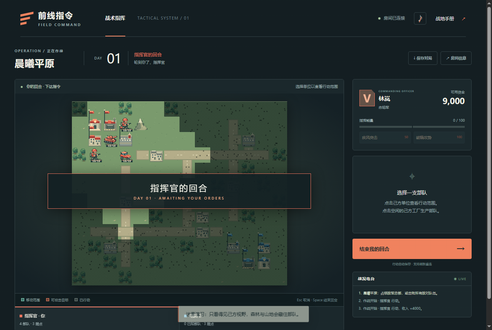
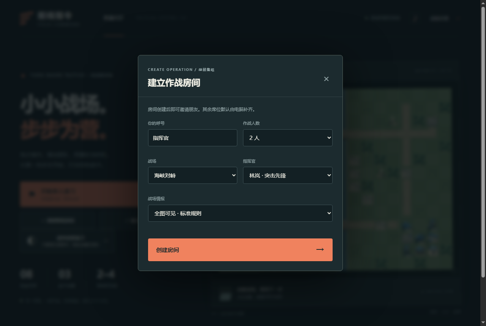
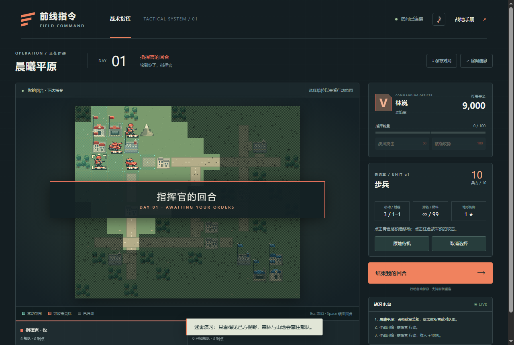
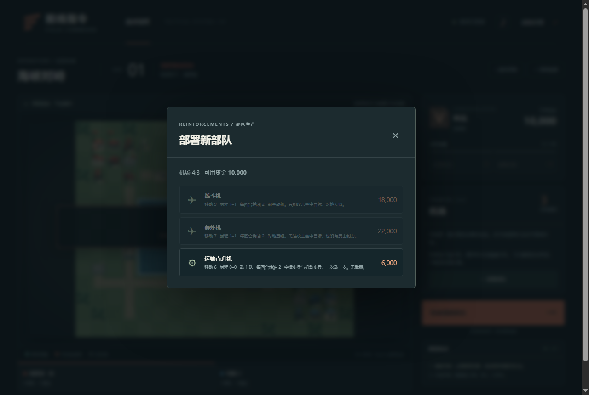

# 前线指令 · FIELD COMMAND

**像素回合制战棋 · 浏览器直接游玩 · 单人演习 / 局域网 2–4 人**

[](package.json)
[](test/)
[](package.json)
[](docs/RULES-CONTRACT.md)
[](#来源授权与贡献)

玩法受 GBA《高级战争 2》启发，规则数值、指挥官与全部像素素材为本项目原创实现，**不是原作的移植或资源提取**。



---

## 目录

- [快速开始](#快速开始)
- [玩法速览](#玩法速览)
- [当前内容](#当前内容)
- [截图](#截图)
- [项目结构](#项目结构)
- [开发进度](#开发进度)
- [规则与文档](#规则与文档)
- [测试](#测试)
- [来源、授权与贡献](#来源授权与贡献)

---

## 快速开始

需要 **Node.js 20 或更新版本**，无需安装任何 npm 依赖。

| 平台 | 启动方式 |
| :--- | :--- |
| Windows | 双击 `开始游戏.bat`，按窗口提示打开浏览器 |
| macOS | 双击 `开始游戏.command`，浏览器会自动打开 |
| 终端 | `npm start`，然后访问 <http://localhost:4173> |

首页三个入口：

- **开始单人演习** —— 直接与电脑对战
- **战争迷雾演习** —— 同一张地图的迷雾规则对局
- **创建联机房间** —— 设置 2–4 个席位、地图、指挥官、对战模式与战争迷雾

---

## 玩法速览

- 点击己方单位查看青色移动范围；点击目的地后选择待机、占领、补给，或点击红色敌军预览并确认攻击。
- 移动与命令一起提交，确认前可随时取消。`Esc` 取消预选，`Space` 打开结束回合确认。
- 步兵与机动步兵可占领城市、工厂、机场、港口与总部；占领速度取决于血量。
- 空闲的己方工厂 / 机场 / 港口可生产部队，新部队下一个己方回合可行动。
- 据点产生收入，并为驻扎的己方部队维修、补给（维修消耗资金）。
- 运输单位可装载相邻友军、在相邻空格卸载；相邻同兵种友军可合并。
- 火炮、火箭炮移动后不能攻击且有最小射程；近战单位在射程与弹药允许时反击。
- 地面单位打不到空中，战斗机只打空中，轰炸机与驱逐舰打地面与舰船。
- 战斗积累指挥能量：50 点发动普通能力，100 点发动超级能力。
- 迷雾房间只显示己方视野，队友共享视野；森林与山地会藏住其中的部队。

完整数值与判定见 **[规则契约](docs/RULES-CONTRACT.md)**。

---

## 当前内容

| 类别 | 内容 |
| :--- | :--- |
| **兵种** | 13 种：步兵、机动步兵、侦察车、轻型坦克、重型坦克、自行火炮、火箭炮、补给车、战斗机、轰炸机、运输直升机、驱逐舰、登陆舰 |
| **地图** | 4 张：晨曦平原 14×12、双桥河谷 18×14、十字要塞 18×16、海峡对峙 18×14 |
| **指挥官** | 2 名原创：林岚（突击先锋）、周衡（战地工程师），各含普通与超级能力 |
| **模式** | 单人对 AI；2–4 人自由混战；4 人 2v2 |
| **对战规模** | 战争迷雾房间级开关 |
| **表现** | 逐格移动、转向、交火演出、击毁与倒下特效、据点升降旗、可开关的合成音效 |
| **界面** | 桌面与触屏布局 |

**尚未实现**：完整战役、地图编辑器、房主自动迁移、公网匹配、旁观模式。

---

## 截图

| 迷雾下的遭遇战 | 海岸登陆作战 |
| :---: | :---: |
|  |  |

| 单位选中与移动范围 | 生产面板 |
| :---: | :---: |
|  |  |

---

## 项目结构

```
field-command-main/
├── public/
│   ├── shared/engine.mjs      共享纯规则引擎：地图、数值、判定、AI（无 DOM / 网络 / 计时器）
│   ├── shared/animation-timing.mjs
│   ├── renderer.mjs           Canvas 像素绘制与坐标交互
│   ├── app.mjs                房间与战场 UI
│   ├── index.html / style.css
│   ├── pixel-font.mjs         像素字体
│   ├── unit-art.mjs           当前游戏使用的冻结版单位美术
│   ├── unit-direction.mjs     四朝向绘制
│   ├── unit-motion.mjs        动作与精灵缓存
│   ├── unit-death.mjs         击毁特效
│   ├── combat-scene.mjs       交火演出
│   ├── capture-scene.mjs      占领演出
│   ├── property-flag.mjs      据点旗帜时序
│   └── art/                   四阵营美术管线（开发中，尚未接入渲染器）
├── server.mjs                 Node HTTP + SSE：服务端校验指令、按房间广播
├── save-store.mjs             版本化原子持久化与备份
├── test/                      152 项测试
├── tools/                     零依赖验证脚本（GUI / 美术）
└── docs/                      规则契约与各阶段验收记录
```

### 架构要点

- **规则与表现分离**：`engine.mjs` 不含任何浏览器 API，同一份代码被服务端与客户端复用。
- **确定性**：伤害无随机数，同一指令序列必得同一状态，联机同步与回放因此简单。
- **服务端权威**：客户端只发送指令，服务端校验、应用并广播状态；席位令牌隔离玩家。
- **迷雾按席位裁剪**：主状态不出服务端进程，快照与 SSE 都按席位投影。

---

## 开发进度

| 阶段 | 内容 | 状态 |
| :--- | :--- | :--- |
| M0 | 工程基线与授权边界 | ✅ |
| M1 | 陆战规则、指令协议、确定性引擎 | ✅ |
| M2 | 幂等、重试、重连、存档 | ✅ |
| M3 | 可交付陆战版 + 真实浏览器验收 | ✅ |
| M4 | 战争迷雾 | ✅ |
| M5 | 海空军、运输、机场 / 港口 | ✅ |
| — | 四阵营像素美术管线 | 🚧 开发中 |
| M6 | 战役与地图编辑器 | ⏸ 未开始 |

详细进度、已知限制与下一步见 **[PROGRESS.md](PROGRESS.md)**。

---

## 规则与文档

| 文档 | 内容 |
| :--- | :--- |
| [RULES-CONTRACT.md](docs/RULES-CONTRACT.md) | 状态字段、伤害公式、地形表、指令协议、迷雾与海空规则 |
| [DEVELOPMENT-BASELINE.md](docs/DEVELOPMENT-BASELINE.md) | 环境、测试基线、冻结范围、来源清单 |
| [M3-ACCEPTANCE.md](docs/M3-ACCEPTANCE.md) | 陆战版 GUI 验收记录 |
| [M4-ACCEPTANCE.md](docs/M4-ACCEPTANCE.md) | 迷雾验收记录 |
| [M5-ACCEPTANCE.md](docs/M5-ACCEPTANCE.md) | 海空军与运输验收记录 |
| [PROGRESS.md](PROGRESS.md) | 开发进度、限制与待办 |

---

## 测试

```bash
npm test
```

**152 项通过 / 0 失败**，约 47 秒。覆盖规则、不变量、契约、迷雾、海空与运输、联机幂等、存档、AI 基准，以及多场完整 HTTP 对局。

测试使用临时端口与临时存档，不会修改正式 `data/` 目录。

真实浏览器验收（需先 `npm start`）：

```bash
node tools/gui-check.mjs      # M1–M4 流程
node tools/gui-check-m5.mjs   # 海战与运输流程
```

---

## 来源、授权与贡献

本仓库是 [Candelor0/field-command](https://github.com/Candelor0/field-command) 的 fork，保留上游来源关系。

> **上游仓库未声明开源许可证。** 公开可见与在 GitHub 内 fork 不等于获得重用、再分发或更改授权。本 fork 不对上游代码另行授予许可证。若要在 fork 功能之外使用代码，请先联系原作者确认许可。

本项目不含任何来自商业游戏的图形、字库、文本或音频；全部像素与音效由代码生成。

欢迎按 [贡献指南](CONTRIBUTING.md) 提交建议或改进。请只贡献自己有权使用的代码与素材；`data/` 中的存档与席位凭证不会纳入版本控制。
